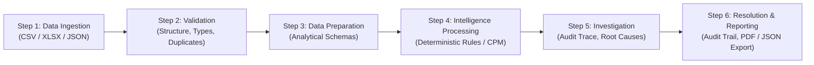

# Decisiq 360

> **Financial Intelligence. Clear decision. Complete control.**

[](https://opensource.org/licenses/MIT)
[]()
[](https://www.typescriptlang.org/)
[](https://react.dev/)
[](https://tailwindcss.com/)
[](https://nodejs.org/)

---

## Table of Contents

- [1. Project Overview](#1-project-overview)
- [2. Problem Statement](#2-problem-statement)
- [3. Proposed Solution](#3-proposed-solution)
- [4. Objectives and Scope](#4-objectives-and-scope)
- [5. System Architecture](#5-system-architecture)
- [6. Core Intelligence Modules](#6-core-intelligence-modules)
  - [Module 01: Reconciliation Intelligence](#module-01-reconciliation-intelligence)
  - [Module 02: Decision Intelligence](#module-02-decision-intelligence)
  - [Module 03: Risk & Exposure Intelligence](#module-03-risk--exposure-intelligence)
  - [Module 04: Close Intelligence](#module-04-close-intelligence)
- [7. Executive Decision Control Room & Cross-Module Intelligence](#7-executive-decision-control-room--cross-module-intelligence)
- [8. Decisiq AI Support & Specialist Assistants](#8-decisiq-ai-support--specialist-assistants)
- [9. Performance Monitoring & Diagnostics Engine](#9-performance-monitoring--diagnostics-engine)
- [10. Data Ingestion, Schemas & Data Flow](#10-data-ingestion-schemas--data-flow)
- [11. Technology Stack](#11-technology-stack)
- [12. Functional Requirements Inventory](#12-functional-requirements-inventory)
- [13. Non-Functional Requirements](#13-non-functional-requirements)
- [14. Security, Privacy & Responsible AI](#14-security-privacy--responsible-ai)
- [15. Installation and Setup](#15-installation-and-setup)
- [16. Configuration and Environment Variables](#16-configuration-and-environment-variables)
- [17. Usage Guide & Workflows](#17-usage-guide--workflows)
- [18. API & Integration Endpoints](#18-api--integration-endpoints)
- [19. Testing & Quality Assurance](#19-testing--quality-assurance)
- [20. Error Handling & Limitations](#20-error-handling--limitations)
- [21. Known Issues, Open Questions & Specification Conflicts](#21-known-issues-open-questions--specification-conflicts)
- [22. Roadmap & Planned Enhancements](#22-roadmap--planned-enhancements)
- [23. Glossary & Domain Reference](#23-glossary--domain-reference)
- [24. License & Project Metadata](#24-license--project-metadata)

---

## 1. Project Overview

**Decisiq 360** is primarily a **Financial Data Analytics and Decision Intelligence** platform, enhanced with AI. It is designed to empower finance teams, controllers, treasury heads, and credit executives to:
1. **Identify financial discrepancies** across disconnected institutional ledgers and bank settlements.
2. **Explain financial decisions** with traceable rules and clear factor attribution.
3. **Monitor risk exposure** and detect conflicting numbers across distributed enterprise systems.
4. **Resolve month-end closing delays** by identifying dependency bottlenecks and critical path constraints.

Financial data in modern institutions is fragmented across siloed databases, disparate general ledgers, sub-ledgers, and third-party bank statements. When these records disagree, finance personnel must manually investigate exceptions, determine root causes, and decide remediation steps. This traditional manual process is time-consuming, difficult to audit, and vulnerable to human error.

Decisiq 360 consolidates these critical workflows into **four independently functioning intelligence modules** supported by shared validation, deterministic computation engines, an immutable local audit trail, and explainable AI reasoning.

---

## 2. Problem Statement

Organizations handling complex financial operations frequently confront four major systemic problems:

```
┌────────────────────────────────────────────────────────────────────────────────────────┐
│                                FOUR CORE FINANCIAL PROBLEMS                            │
├──────────────────────────┬──────────────────────────┬──────────────────────────────────┤
│ Problem 1:               │ Problem 2:               │ Problem 3:                       │
│ Financial Reconciliation │ Decision Explainability  │ Risk & Exposure Visibility       │
│                          │                          │                                  │
│ Mismatched amounts,      │ Credit/underwriting apps │ Conflicting figures across       │
│ missing transactions,    │ declined or flagged      │ ERP, treasury, and trading desks │
│ duplicate postings, and  │ without clear, audited   │ obscure true net exposure and    │
│ inconsistent reference   │ evidence of the rules    │ limit breach severity.           │
│ numbers delay closes.    │ or factors involved.     │                                  │
├──────────────────────────┴──────────────────────────┴──────────────────────────────────┤
│ Problem 4: Month-End Closing Delays                                                    │
│ Unresolved discrepancies, missing journal lines, and serial task dependencies          │
│ delay financial close, with no predictive visibility into bottlenecks.                 │
└────────────────────────────────────────────────────────────────────────────────────────┘
```

1. **Problem 1: Financial Reconciliation Exceptions**  
   Financial records originating from distinct sources (e.g., bank statements vs. internal general ledgers) contain mismatched amounts, missing transactions, duplicate entries, or inconsistent references. Manually locating and reconciling these exceptions creates operational lag and compliance risk.
2. **Problem 2: Lack of Financial Decision Explainability**  
   Loan or credit underwriting applications may be declined, approved, or flagged, but operations teams struggle to communicate precisely which rules, debt ratios, or counterparty factors drove the decision. Discretionary policy overrides frequently bypass audit oversight.
3. **Problem 3: Fragmented Risk and Exposure Visibility**  
   Financial numbers distributed across multiple systems (e.g., internal ERP vs. external Treasury/custodian feeds) conflict with one another. Consequently, risk managers struggle to determine true institutional exposure, identify abnormal concentration changes, and prioritize counterparty breaches.
4. **Problem 4: Month-End Closing Delays**  
   Unresolved discrepancies and unmapped task dependencies push back financial closing milestones. Accounting teams lack real-time visibility into active blockers, their potential financial/operational impact, and the exact critical path required to reach books closure.

---

## 3. Proposed Solution

Decisiq 360 delivers an **independent, four-module intelligence suite** where each module operates with its own processing logic and dedicated workspace while leveraging shared ingestion, validation, storage, and security layers:

1. **Reconciliation Intelligence (Module 01)**: Compares counterparty records, flags tolerance variances and missing entries, categorizes exceptions, and isolates residual net variance.
2. **Decision Intelligence (Module 02)**: Evaluates credit underwriting batches against deterministic policy rules, explains outcomes with quantitative evidence, and detects divergent overrides.
3. **Risk & Exposure Intelligence (Module 03)**: Highlights conflicting positions across treasury and ledger systems, computes gross and net exposures with collateral offsets, and surfaces limit breaches.
4. **Close Intelligence (Module 04)**: Models month-end task sequences using the Critical Path Method (CPM), isolates zero-slack bottlenecks, and alerts on circular prerequisite loops.

### The 6-Step Operating Lifecycle



- **Step 1 — Data Ingestion**: The user uploads financial files containing public or synthetic data in CSV, XLSX, or JSON formats.
- **Step 2 — Validation**: System validates structure, verifies required headers, checks data types, detects missing values, and identifies potential duplicate rows.
- **Step 3 — Data Preparation**: Ingested records are normalized into standardized analytical schemas with strict type coercion.
- **Step 4 — Intelligence Processing**: The selected module executes specialized computation passes using deterministic rules, mathematical aggregations, or AI-assisted reasoning.
- **Step 5 — Investigation**: Detected issues, relevant evidence rows, root-cause hypotheses, severity ratings, and recommended remediation actions are presented to the operator.
- **Step 6 — Resolution & Reporting**: Operators review findings, record human decisions (`approved`, `rejected`, `flagged`), and export comprehensive executive briefings and audit logs.

---

## 4. Objectives and Scope

### Primary Objectives
- Automate exception detection across financial data files with zero false-negative tolerance.
- Provide auditable, rule-by-rule mathematical transparency for all underwriting and policy decisions.
- Deliver real-time gross/net counterparty exposure analytics with collateral calculations.
- Compute earliest month-end close cycle timelines and zero-slack task sequences via CPM.
- Ensure strict privacy, sandboxed execution, and offline-first operation.

### Secondary Objectives
- Enable AI-assisted investigation dialogs powered by Gemini 2.5 Flash for natural-language explanations.
- Provide immutable audit logging for all uploads, engine runs, and human review actions.
- Real-time engine latency and heap memory telemetry with P95 anomaly alerting.

### In-Scope Functionality
- Bank-to-ledger reconciliation with sign-convention inversion (Debit $\leftrightarrow$ Credit).
- Underwriting policy auditing (Debt-to-Income, FICO scores, employment tenure, delinquency caps).
- Counterparty concentration risk, limit utilization, cross-system variance detection, and proportional stress-testing.
- CPM task graph scheduling, cycle detection, slack calculation, and blocker tracking.
- Executive Decision Control Room with 6-week historical findings trending and sparklines.
- Interactive support assistant with deterministic offline fallback.
- Export of audit trails (JSON) and executive briefings (PDF/JSON).

### Explicitly Excluded Functionality
- Live write-back to production banking cores or external ERPs (read-only analytical sandbox).
- Ingestion of live, non-consensual employer or proprietary competitor financial data.
- Black-box automated trading or autonomous loan disburals without mandatory human sign-off.

---

## 5. System Architecture

The Decisiq 360 architecture follows a 4-layer design enforcing strict separation of concerns:

```
┌────────────────────────────────────────────────────────────────────────┐
│                   LAYER 1: USER EXPERIENCE LAYER                       │
│  File Upload Zone │ Module Workspaces │ Executive Control Room         │
│  Results Visualizations │ Exception Drawers │ AI Support & Search      │
└──────────────────────────────────┬─────────────────────────────────────┘
                                   │
┌──────────────────────────────────▼─────────────────────────────────────┐
│             LAYER 2: INDEPENDENT MODULE SERVICES                       │
│  Reconciliation    │ Decision           │ Risk & Exposure │ Close      │
│  Intelligence      │ Intelligence       │ Intelligence    │ Intell.    │
└──────────────────────────────────┬─────────────────────────────────────┘
                                   │
┌──────────────────────────────────▼─────────────────────────────────────┐
│               LAYER 3: SHARED PROCESSING SERVICES                      │
│  File Ingestion & Parsing │ Type Coercion & Schema Validation         │
│  Deterministic Rules Engine │ Audit Trail & Review Management         │
│  Performance Profiling & Latency Diagnostics (P95 Monitor)             │
└──────────────────────────────────┬─────────────────────────────────────┘
                                   │
┌──────────────────────────────────▼─────────────────────────────────────┐
│             LAYER 4: ANALYTICAL DATA & STORAGE PLATFORM                │
│  Client-Side Deterministic Stores │ LocalStorage Persistence           │
│  Express Backend API Proxy │ Exasol Personal / SQL Analytical Layer*   │
└────────────────────────────────────────────────────────────────────────┘
```
*\*Note: Exasol Personal is designated in the PDF specification as the target analytical platform. In this web prototype, client-side TypeScript engines provide instant deterministic execution with zero cloud dependency.*

---

## 6. Core Intelligence Modules

### Module 01: Reconciliation Intelligence
- **Accent Theme**: Warm Gold (`#FFD629` / Module 01)
- **Objective**: Match records between primary bank/settlement feeds and secondary general ledger/invoice files to isolate discrepancies and residual variance.
- **Key Inputs**:
  - `Source A`: Bank Statement (`Transaction_ID`, `Date`, `Amount`, `Currency`, `Type`, `Reference`, `Counterparty`, `Description`).
  - `Source B`: General Ledger (`Entry_ID`, `Posting_Date`, `Net_Amount`, `Currency`, `Direction`, `Invoice_No`, `Payee`, `Narrative`).
- **Processing Logic**:
  - Opposite sign matching: Bank Credit matches Ledger Debit; Bank Debit matches Ledger Credit.
  - Amount tolerance checks (configurable, default $\pm\$0.05$).
  - Reference number normalization and date window comparisons ("Same Day" to configurable tolerance).
  - Categorization into `Exact Match`, `Tolerance Discrepancy`, `Unmatched Source A`, and `Unmatched Source B`.
- **Sample Performance Baseline (PDF Page 7)**:
  - **Reconciliation Rate**: 80.0% (6 matched)
  - **Matched Volume**: $266,680.65 (1-to-1 Validated)
  - **Discrepancies**: 1 tolerance flag (+$0.05)
  - **Unmatched Source A**: 2 items ($9,300.00 total)
  - **Unmatched Source B**: 1 item ($12,400.00 total)
  - **Net Variance**: $3,100.00 residual delta

---

### Module 02: Decision Intelligence
- **Accent Theme**: Emerald Green (`#10B981` / Module 02)
- **Objective**: Audit credit underwriting batches against deterministic policy rules to explain outcomes and expose unapproved human overrides.
- **Active Policy**: Standard Retail Credit & Mortgages Policy (2.1.0)
  - **Rule 1 (DTI Cap)**: Debt-to-Income ratio $\le 43.0\%$
  - **Rule 2 (FICO Floor)**: Credit Score $\ge 640$
  - **Rule 3 (Employment Stability)**: Employment tenure $\ge 12$ months
  - **Rule 4 (Delinquencies)**: Active delinquencies count $= 0$
- **Processing Logic**:
  - Re-evaluates each application mathematically.
  - Compares computed verdict against the recorded outcome (`APPROVED` vs. `DECLINED`).
  - Categorizes rows into `Policy Conforming` or `Divergent Override`.
- **Sample Performance Baseline (PDF Page 8)**:
  - **Total Applications Evaluated**: 6
  - **Computed Passes**: 3 satisfied all rules
  - **Computed Declines**: 3 breached thresholds
  - **Recorded in Source**: 4 Approved / 2 Declined
  - **Policy Conflicts**: 1 Divergent Override (App APP-2026-05: 70.0% DTI and 620 FICO was marked Approved in source).

---

### Module 03: Risk & Exposure Intelligence
- **Accent Theme**: Rose Pink (`#FB7185` / Module 03)
- **Objective**: Consolidate institutional counterparty exposures, calculate collateral offsets, detect cross-system discrepancies, and monitor limit utilization.
- **Processing Logic**:
  - Calculates Gross Exposure $\sum (\text{deal positions})$ and Net Exposure $(\text{Gross} - \text{Collateral})$.
  - Detects credit limit breaches when Net Exposure $>$ Configured Limit.
  - Flags concentration risks where single counterparty exceeds $20\%$ of total gross portfolio.
  - Identifies cross-system valuation mismatches between internal Treasury feeds and ERP ledger records.
- **Sample Performance Baseline (PDF Page 9)**:
  - **Total Gross Exposure**: $27,656,000.00 across 6 deals
  - **Net Exposure**: $23,592,000.00 after collateral offsets
  - **Active Limit Breaches**: 1 (Apex Clearing Corp at $8.5M vs $7.0M limit / 121.4% utilization)
  - **Top Obligor Concentration**: 30.73% (Apex Clearing Corp)
  - **Cross-System Variances**: 1 (Treasury vs. ERP mismatch)
  - **Average Portfolio Limit Utilized**: 92.7%

---

### Module 04: Close Intelligence
- **Accent Theme**: Royal Purple (`#A855F7` / Module 04)
- **Objective**: Track month-end financial task dependencies, compute critical path schedules using graph algorithms, and detect circular blocking loops.
- **Processing Logic**:
  - Builds a Directed Acyclic Graph (DAG) of closing tasks.
  - Executes topological sort and cycle detection (Tarjan/DFS). Circular prerequisite loops instantly trigger a failure state with the exact loop members isolated.
  - Calculates Early Start, Early Finish, Late Start, Late Finish, and Total Slack.
  - Highlights the **Zero-Slack Critical Path Sequence** determining total project duration.
- **Sample Performance Baseline (PDF Page 10)**:
  - **Completion Rate**: 22.2% (2 of 9 tasks completed)
  - **Critical Path Duration**: 18 Hours (Earliest close cycle)
  - **Critical Path Tasks**: 5 zero-slack tasks
  - **Active Blockers**: 8 unfinished dependencies
  - **In Progress**: 2 tasks | **Not Started**: 4 tasks
  - **Critical Sequence Tasks**:
    1. `TASK-01`: Bank & Depository Ingestion (3h, Slack 0.0h) - Completed
    2. `TASK-02`: Intercompany Balance Matching (6h, Slack 0.0h) - In Progress
    3. `TASK-03`: Treasury & FX Revaluation Pass (4h, Slack 0.0h) - Not Started
    4. `TASK-04`: Preliminary Trial Balance Generation (3h, Slack 0.0h) - Blocked
    5. `TASK-05`: Executive Financial Close Sign-off (2h, Slack 0.0h) - Not Started

---

## 7. Executive Decision Control Room & Cross-Module Intelligence

The **Executive Decision Control Room** (PDF Page 11) consolidates intelligence across all 4 departments into a high-level briefing for the CFO, CRO, and audit committees:

1. **Reconciliation Health Card**: 80.0% Match Rate, 3 unmatched items (Attention status, Mean: 4 items).
2. **Credit Policy Integrity Card**: 1 Discretionary Override across 6 applications (Critical status, +11% above 2.7 mean).
3. **Treasury Risk & Limits Card**: 1 Active Breach, 30.73% max concentration (Critical status, -12% below 5.7 mean).
4. **Month-End Close Timeline Card**: 22.2% Complete, 7 critical path blockers (Critical status, +11% above 5.1 mean).
5. **Historical Findings Volume & Department Trends Chart**:
   - 6-week horizon trend with mean baseline ($18.7\text{ findings/week}$).
   - Active Week 19 tracking: $+2\%$ above average ($112$ total historical findings logged).
6. **Executive Briefing Dossier**: One-click generation and PDF/JSON export synthesizing all findings, material dollar exposures, and root-cause summaries.

---

## 8. Decisiq AI Support & Specialist Assistants

Decisiq 360 integrates contextual AI assistance (PDF Pages 2, 4, 12, 13) designed around **Responsible AI Principles**:

- **System Assistant**: Side drawer answering file format queries, navigation assistance, and financial concept explanations.
- **Dedicated Module Specialists**:
  - `Reconciliation Agent`: Investigates unmatched timing differences vs. true phantom postings.
  - `Decision Underwriting Agent`: Breaks down affordability formulas and policy breach factors.
  - `Risk Specialist`: Models portfolio stress scenarios and counterparty contagion.
  - `Close Specialist`: Analyzes prerequisite bottlenecks and recommends task re-ordering.
- **Deterministic Offline Fallback**: If internet connectivity is unavailable or Gemini API keys are unconfigured, all assistants gracefully switch to rule-based deterministic response engines without failing.
- **Anti-Hallucination Guardrails**: AI assistants are strictly constrained to uploaded data evidence. They never present unverified hypotheses as confirmed facts.

---

## 9. Performance Monitoring & Diagnostics Engine

Decisiq 360 features a dedicated **System Health & Latency Telemetry Dashboard**:

- **Sub-Millisecond Profiling**: Tracks execution duration via `performance.now()`.
- **Heap & Memory Tracking**: Monitors client JS heap utilization and storage footprint per module key.
- **P95 Latency Threshold Alerting**: Computes the 95th percentile ($P_{95}$) execution duration across historical runs. If an engine run exceeds $P_{95}$, it:
  1. Displays a high-contrast Neobrutalist **Performance Alert** warning notification.
  2. Permanently writes a `PERFORMANCE_ALERT` event into the immutable audit trail.
- **Synthetic Micro-Benchmark**: Non-destructive diagnostic benchmark measuring throughput (records/sec) across all 4 engines.

---

## 10. Data Ingestion, Schemas & Data Flow

### Supported File Formats
- **CSV (`.csv`)**: Primary tabular format.
- **Excel (`.xlsx`, `.xls`)**: Multi-sheet workbooks.
- **JSON (`.json`)**: Structured financial exports.
- *(PDF, OFX, TXT referenced in UI mockup for future parsers)*.

### Standard Analytical Schemas

#### Reconciliation Engine Schema
```typescript
interface ReconRecord {
  id: string;
  sourceFileId: string;
  sourceRole: 'source_a' | 'source_b';
  sourceName: string;
  rowNumber: number;
  transactionId: string;
  date: string;
  amount: number;
  currency: string;
  direction: 'debit' | 'credit';
  reference: string;
  counterparty?: string;
  description?: string;
}
```

#### Decision Engine Schema
```typescript
interface DecisionApplication {
  id: string;
  applicantName: string;
  requestedAmount: number;
  grossMonthlyIncome: number;
  monthlyDebtObligations: number;
  computedDTI: number;
  creditScore: number;
  employmentMonths: number;
  delinquenciesCount: number;
  recordedOutcome: 'APPROVED' | 'DECLINED' | 'FLAGGED';
}
```

#### Risk & Exposure Schema
```typescript
interface PositionRecord {
  id: string;
  counterparty: string;
  instrument: string;
  exposureAmount: number;
  currency: string;
  reportingDate: string;
  configuredLimit: number;
  collateralAmount: number;
  systemSource: 'TREASURY' | 'ERP_LEDGER';
}
```

#### Close Task Schema
```typescript
interface CloseTask {
  id: string;
  taskName: string;
  owner: string;
  status: 'COMPLETED' | 'IN_PROGRESS' | 'NOT_STARTED' | 'BLOCKED';
  durationHours: number;
  dueDate: string;
  predecessorIds: string[];
}
```

---

## 11. Technology Stack

| Layer | Technology | Purpose |
| :--- | :--- | :--- |
| **Frontend Framework** | React 19 + TypeScript | Component-driven UI with strict typing |
| **Build & Dev Tooling** | Vite 8 + TSX | Instant hot-reloading and modern ESM bundling |
| **Styling & Design System** | Tailwind CSS v4 | High-contrast Neobrutalist aesthetics (`shadow-neo`, `border-2 border-black`) |
| **Icons & Visuals** | Lucide React | High-contrast iconography |
| **Charts & Sparklines** | Recharts | Department trends and multi-line historical charts |
| **File Parsing** | XLSX + Custom CSV/JSON Parser | High-performance client-side spreadsheet ingestion |
| **PDF Generation** | jsPDF + html2canvas | Audit-grade executive dossier exports |
| **AI Reasoning Layer** | Google GenAI SDK (`gemini-2.5-flash`) | Contextual explanations and assistant queries |
| **Backend API Server** | Node.js + Express | Proxy routes for Gemini API and production static serving |
| **Data Platform (Spec)** | Exasol Personal / SQL* | Target relational analytics platform defined in PDF specification |

---

## 12. Functional Requirements Inventory

| ID | Module / Area | Description | Expected Behavior | Status |
| :--- | :--- | :--- | :--- | :--- |
| **REQ-001** | General | 4 Independent Modules | Module isolation: data in one module never mutates another | Verified |
| **REQ-002** | Ingestion | Multi-file Parsing | Accepts CSV, XLSX, JSON up to 25 MB | Verified |
| **REQ-003** | Recon | Opposite-Sign Match | Credit matches Debit on same date within amount tolerance | Verified |
| **REQ-004** | Recon | Variance Calculation | Flags tolerance discrepancies ($> \$0.00$ up to $\$0.05$) | Verified |
| **REQ-005** | Decision | DTI & FICO Audit | Evaluates $\text{DTI} \le 43\%$, $\text{FICO} \ge 640$ deterministically | Verified |
| **REQ-006** | Decision | Override Detection | Flags approvals where computed evaluation indicates decline | Verified |
| **REQ-007** | Risk | Exposure Aggregation | Computes Gross Exposure and Net Exposure with collateral | Verified |
| **REQ-008** | Risk | Limit Breach Detection | Flags positions where Net Exposure exceeds Configured Limit | Verified |
| **REQ-009** | Close | CPM Graph Scheduling | Computes critical path, early/late start, and task slack | Verified |
| **REQ-010** | Close | Cycle Detection | Identifies circular dependencies and halts invalid schedules | Verified |
| **REQ-011** | Control Room | Cross-Module Briefing | Consolidated cards with 6-week historical trend lines | Verified |
| **REQ-012** | Telemetry | P95 Latency Alert | Triggers alert and audit entry if execution exceeds $P_{95}$ | Verified |
| **REQ-013** | Storage | Independent Clear | Clear All resets only the active module's documents | Verified |
| **REQ-014** | Audit | Immutable Audit Trail | Logs all uploads, runs, alerts, and reviews with JSON export | Verified |

---

## 13. Non-Functional Requirements

- **Performance**:
  - Deterministic calculations execute within $< 50\text{ ms}$ for standard batches ($< 500$ rows).
  - Sub-second UI updates across filtering, sorting, and tab switching.
  - Automatic $P_{95}$ latency tracking and profiling on every run.
- **Reliability & Determinism**:
  - Calculation results are 100% deterministic: identical inputs yield identical outputs.
  - Floating-point currency calculations use safe cent-rounding to eliminate IEEE-754 precision errors.
- **Availability & Offline-First**:
  - 100% operational offline without active internet connection.
  - AI features gracefully fall back to deterministic responses when offline.
- **Maintainability & Architecture**:
  - Modular directory layout adhering to clean feature separation boundaries.
  - Zero circular dependencies across engines and components.

---

## 14. Security, Privacy & Responsible AI

Decisiq 360 enforces **12 mandatory security and privacy rules** directly specified in the project charter (PDF Pages 12-13):

1. **Synthetic & Public Data Only**: The application operates strictly on public or synthetic datasets. No proprietary employer or competitor records are ingested.
2. **Offline-First Resilience**: Local analytical functionality must never depend on an active cloud connection.
3. **Explicit Online Consent**: Internet availability must never automatically trigger telemetry or transmit user financial data to third-party endpoints.
4. **Transparent Disclosure**: Any external AI call explicitly states the provider (Google Gemini), model name, and prompt context.
5. **Data Minimization**: Only the minimum necessary fields are passed to AI services; raw balances and identifying information are redacted where possible.
6. **Secure File Handling**: File parser validates extensions, verifies MIME types, rejects corrupted structures, and guards against path traversal.
7. **Zero Hardcoded Secrets**: API keys, tokens, and credentials are never stored in source code or committed to repositories.
8. **Auditable Evidence Over Black-Box AI**: Findings must cite traceable rows, SQL queries, or explicit policy rules. AI-generated explanations are visually labeled and cannot assert root causes without verifiable evidence.
9. **Role-Based Access Control**: Multi-user permissions are enforced on the server/API layer, not merely cosmetically in the UI.
10. **Data Isolation & Scoped Deletion**: The "Clear All" action purges stored uploads, cached runs, and findings strictly within the targeted module. Destructive actions require explicit modal confirmation.
11. **Sanitized Logging**: File contents, credentials, and sensitive personal data are never written to server or console logs.
12. **AI Safeguards**: Uploaded document text and column values are treated strictly as untrusted data, never as prompt instructions to override business rules.

---

## 15. Installation and Setup

### Prerequisites
- **Node.js**: v20.x or v22.x LTS installed.
- **Package Manager**: `npm` (v10+), `yarn`, or `bun`.

### Step-by-Step Setup

1. **Clone the Repository**:
   ```bash
   git clone https://github.com/your-org/decisiq-360.git
   cd decisiq-360
   ```

2. **Install Dependencies**:
   ```bash
   npm install
   ```

3. **Configure Environment Variables**:
   ```bash
   cp .env.example .env
   ```
   *(Optional: Add `GEMINI_API_KEY` in `.env` if enabling live Gemini AI support responses).*

4. **Launch the Development Server**:
   ```bash
   npm run dev
   ```
   Open your browser at `http://localhost:3000`.

5. **Build for Production**:
   ```bash
   npm run build
   npm run start
   ```

---

## 16. Configuration and Environment Variables

| Variable | Required? | Default | Description |
| :--- | :--- | :--- | :--- |
| `PORT` | Optional | `3000` | Port for the Express server and Vite middleware |
| `NODE_ENV` | Optional | `development` | Runtime environment (`development` or `production`) |
| `GEMINI_API_KEY` | Optional | None | Google GenAI API key for AI Support and specialist agent responses |
| `APP_URL` | Optional | Auto-detected | Fully qualified domain URL for hosting |

---

## 17. Usage Guide & Workflows

### 1. Reconciling Bank Statements Against Ledgers
1. From the Top Navigation, click **Reconciliation**.
2. Upload primary settlement file (Source A) and internal general ledger (Source B).
3. Review the **Quick Stats Banner** showing Match Rate and Volume.
4. Click **Run Reconciliation**.
5. Use the filter tabs (`Discrepancies`, `Unmatched A`, `Unmatched B`) to inspect flagged items.
6. Click **Audit Trace** on any row to open the complete row-level evidence drawer.
7. Click **AI Investigation** to generate a root-cause hypothesis.

### 2. Auditing Underwriting Decisions
1. Navigate to **Decision Intelligence**.
2. Upload credit applications batch (`.csv`, `.xlsx`, or `.json`).
3. Click **Run Decision Audit**.
4. Filter by **Policy Conflicts** to isolate divergent overrides where high DTI or low FICO was marked Approved.
5. Review the mathematical breakdown of monthly obligations vs. gross income.

### 3. Monitoring Risk Exposures & Limit Breaches
1. Navigate to **Risk & Exposure Intelligence**.
2. Upload treasury positions and ERP secondary records.
3. Click **Run Risk Analysis**.
4. Examine the **Portfolio Concentration Chart** and note any counterparty marked with a `BREACH` badge.
5. Switch to **Stress Testing** to simulate interest rate shocks and FX devaluations in real-time.

### 4. Month-End Close Dependency Scheduling
1. Navigate to **Close Intelligence**.
2. Upload the close task checklist with predecessor task IDs.
3. Click **Run Close Scheduling**.
4. Review the **Zero-Slack Critical Path Sequence** showing earliest close duration.
5. If tasks contain circular dependencies, inspect the immediate error alert detailing the loop.

### 5. Reviewing System Health & Audits
- Click **Health** in the top navigation to view engine latencies, $P_{95}$ timings, and memory consumption.
- Click **Audit** in the top navigation to inspect the immutable log and export the JSON audit trail.

---

## 18. API & Integration Endpoints

The Express server exposes the following endpoints:

### `POST /api/support`
Contextual AI assistance powered by Gemini with deterministic fallback.

- **Request Body**:
  ```json
  {
    "message": "Explain how Debt-to-Income is calculated",
    "history": [],
    "context": {
      "activeModule": "decision",
      "hasResults": true
    }
  }
  ```
- **Response**:
  ```json
  {
    "reply": "Debt-to-Income (DTI) is calculated as (Monthly Debt / Gross Income) * 100...",
    "provider": "gemini"
  }
  ```

---

## 19. Testing & Quality Assurance

Decisiq 360 features an automated test suite verifying deterministic calculations, CPM graph theory, floating-point math, and performance alerting:

```bash
# Run complete test suite (26 passing tests)
npm test

# Run TypeScript type check
npm run lint
```

### Test Coverage Highlights
- `reconciliation.test.ts`: Exact matches, sign conventions, tolerance thresholds, and residual variances.
- `decision.test.ts`: DTI boundary limits, FICO scoring, override detection, zero-income division guards.
- `risk.test.ts`: Currency conversion, gross/net offsets, concentration shares, and scenario stresses.
- `close.test.ts`: CPM serial/parallel schedules, slack calculations, and cycle detection.
- `performance.test.ts`: $P_{95}$ percentile interpolation, latency anomaly triggers, and memory calculations.
- `storage.test.ts`: Scoped module isolation, weekly aggregation trends, and demo data purging.

---

## 20. Error Handling & Limitations

- **File Validation**: Rejects files exceeding 25 MB or missing required headers with clear in-app messages.
- **Circular Task Loops**: Close engine halts and highlights exact task loops if a circular dependency is detected.
- **Zero Division Guards**: Debt-to-income equations gracefully handle $0 gross income by assigning 100% DTI rather than throwing NaN.
- **Browser Memory Boundaries**: Storage relies on client `localStorage` with active footprint monitoring. Large datasets ($> 50,000$ rows) should be pre-filtered.

---

## 21. Known Issues, Open Questions & Specification Conflicts

The following items are recorded for project stakeholders and future architectural phases:

1. **Analytical Platform Integration (Exasol Personal vs. Client Engines)**:
   - *PDF Specification*: Page 4, Step 3 states data is loaded into **Exasol Personal** and analyzed via SQL queries.
   - *Current Web Implementation*: Uses pure, high-performance client-side TypeScript engines for zero-dependency local execution.
   - *Status*: Open architectural decision whether to integrate an external Exasol container connector for enterprise data volumes or retain client-side engines.
2. **Additional File Parsers**:
   - UI mockups on Page 2 reference PDF, OFX, and TXT upload formats. Currently, CSV, XLSX, and JSON are fully implemented.

---

## 22. Roadmap & Planned Enhancements

- [x] Phase 1: Core Deterministic Engines (Reconciliation, Decision, Risk, Close).
- [x] Phase 2: Executive Decision Control Room with 6-Week Trending.
- [x] Phase 3: Performance Telemetry & $P_{95}$ Latency Alerting.
- [x] Phase 4: Gemini AI Support & Specialized Investigation Agents.
- [ ] Phase 5: Exasol Personal JDBC/ODBC connector pipeline for multi-million row analytics.
- [ ] Phase 6: Direct OFX / QFX bank feed parser.
- [ ] Phase 7: Cryptographic SHA-256 hash chaining on the Immutable Audit Trail.

---

## 23. Glossary & Domain Reference

- **CPM (Critical Path Method)**: Mathematically identifies the longest sequence of dependent tasks that determines the minimum project completion time.
- **DTI (Debt-to-Income)**: Percentage of monthly gross income dedicated to servicing ongoing monthly debt obligations.
- **Divergent Override**: An underwriting decision where recorded approval contradicts computed policy rule evaluations.
- **Net Residual Variance**: Total unmatched monetary difference between primary settlement records and secondary general ledger accounts.
- **P95 Latency**: The 95th percentile execution duration; 95% of analysis runs complete within this timeframe.
- **Slack (Float)**: Amount of time a task can be delayed without delaying subsequent tasks or the project close date.

---

## 24. License & Project Metadata

- **License**: MIT License ([LICENSE](./LICENSE))
- **Author**: Decisiq 360 Core Engineering
- **Version**: 1.0.0
- **Source Specification**: `Report_f6261a5a.pdf` (13 Pages, October 2026)
